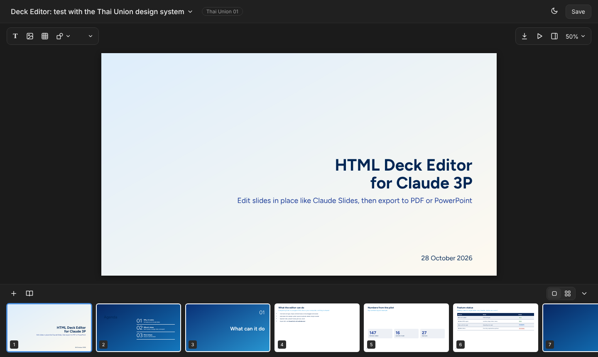
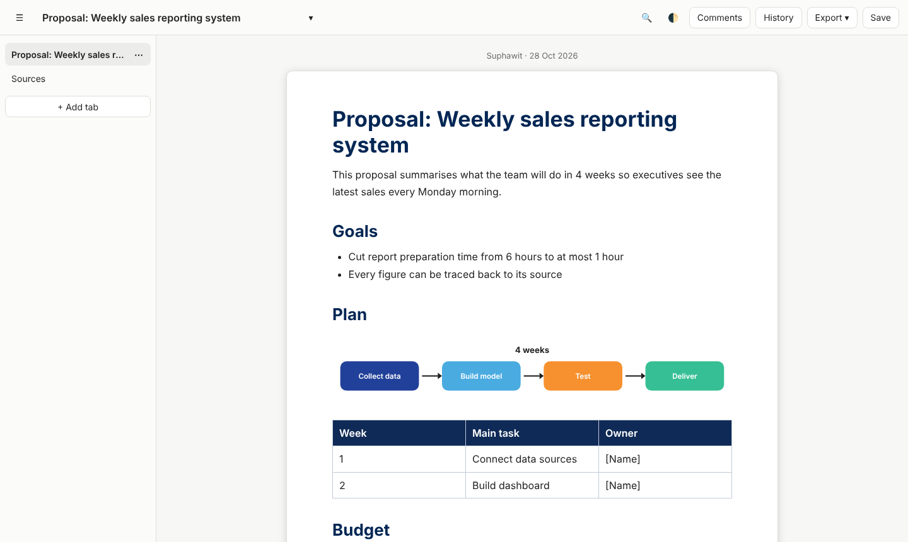

# dev-claude-artifact-for-3P

These two tools are **clones of Claude's Slides and Docs artifacts** for use in **Claude 3P mode**, where those artifact types are not available.
They work the same way: ask Claude to "create slides" or "create a document", Claude writes the file, and it opens in a local editor where you
edit it like on claude.ai and then export it. Files stay on your computer, nothing is shared, and you can **use your own design system**
(see below).

| Tool | Replaces | Folder | Skill |
|---|---|---|---|
| Design Slide | Claude Slides | `design-slide/` | `skills/design-slide/` |
| Design Doc | Claude Docs | `design-doc/` | `skills/design-doc/` |

## What the tools look like

**Design Slide** (sample deck using the Thai Union design system)



**Design Doc** (multi-tab document with diagram, table, Comments / History / Export)



## Quick start

Needs Node.js and Chrome, Chromium or Edge.

```bash
# Slides: open the sample deck (same file format as Claude Slides)
node design-slide/open-deck.mjs design-slide/examples/slides-format --ds tu

# Docs: open the sample document
node design-doc/open-doc.mjs design-doc/examples/proposal --ds tu --byline "Your name"
```

Each command prints `OPEN: http://localhost:...`; open that address in the Claude desktop browser pane (or any browser).

## Use in Claude 3P

Copy `skills/design-slide/` and `skills/design-doc/` to `~/.claude/skills/`, and set `DESIGN_SLIDE_DIR` / `DESIGN_DOC_DIR` to the full path of
this repo's `design-slide/` / `design-doc/` folder. Then ask for "create slides" or "create a document": Claude follows the same design rules
as Claude Slides/Docs but opens the result in Design Slide / Design Doc.

## Create your own design system

A design system is a small JavaScript file that the tool loads before `editor.js`. The example is Thai Union (`ds-tu.js`, used with `--ds tu`).

1. Slides: copy `design-slide/ds-tu.js` to `design-slide/ds-<name>.js` and edit `window.DECK_DS`: `name`, `width/height`, `fonts`,
   `colors`, `textStyles`, `css` and `layouts` (the layouts offered by the "+" button).
2. Docs: copy `design-doc/ds-tu.js` to `design-doc/ds-<name>.js` and edit `window.DOC_DS`: `name`, `fonts`, `colors`, `chart`, `css`.
3. Open with `--ds <name>`, for example `node design-slide/open-deck.mjs <deck folder> --ds acme`.

To be upfront: there is no generator for design systems yet, so the `ds-*.js` file has to be written by hand (or by Claude from a brand
guide), and it has only been tested with the Thai Union design system.

---

## Design Slide

A local HTML slide deck editor that works like Claude Slides: edit text in place, select and move anything, floating
toolbars, design-system text styles and colours, filmstrip, grid view, present, and export to PDF or an editable PowerPoint
file. Decks stay on your computer; nothing is shared.

- `design-slide/` — the editor (`editor.js`, `editor.css`), the local server (`serve.mjs`), the Thai Union design system
  (`ds-tu.js` + `tu-bg-*.png`), two sample decks (`tu-test.html`, `deck.html`) and the gap list against Claude Slides
  (`design-slide-gap.md`).
- `design-slide/test/` — headless Edge UI tests (`node design-slide/test/run-all.mjs`).

### Use it from Claude 3P ("create slides")

`skills/design-slide/` is a skill that stands in for Claude Slides. Asked to create or change slides, Claude writes the deck in the
Claude Slides file format (`project/deck.json` and `project/slides/<id>.html`, rules in `skills/design-slide/format.md`, the same
design rules Claude Slides uses), then runs `node design-slide/open-deck.mjs <deck folder>`, which builds `deck.html`, starts the
local server and prints the address to open in the Claude desktop browser pane. The deck then opens in Design Slide, and
Ctrl+S saves edits into `deck.html`.

Install: copy `skills/design-slide/` to `~/.claude/skills/design-slide/` (or the project's `.claude/skills/`) and set
`DESIGN_SLIDE_DIR` to the full path of this repo's `design-slide/` folder. Try it with the sample deck:
`node design-slide/open-deck.mjs design-slide/examples/slides-format`.

### Run

```bash
node design-slide/serve.mjs
```

Then open http://localhost:4190/tu-test.html. To edit decks kept in another folder: `node design-slide/serve.mjs <deck folder>`.
The server listens on localhost only. A deck links `editor.css`, an optional design system (`ds-*.js`) and `editor.js`.

### Status

All groups of the gap list (`design-slide/design-slide-gap.md`) are built and covered by tests, apart from the points that file marks
as partly done (connector routes and snapping, magic-move transitions, build animations). `node design-slide/test/run-all.mjs` runs every
check (about 4 minutes; needs Chrome, Chromium or Edge, and `unzip` outside Windows; set `BROWSER` to a browser path if none is found).

## Design Doc

A local HTML document editor that stands in for Claude Docs in 3P mode: tabs, floating toolbar, `/` menu, tables, charts, diagrams, comment threads, version history and export to Word, PDF and Markdown. See `design-doc/README.md`; the skill is `skills/design-doc/`; tests: `node design-doc/test/run-all.mjs`.
